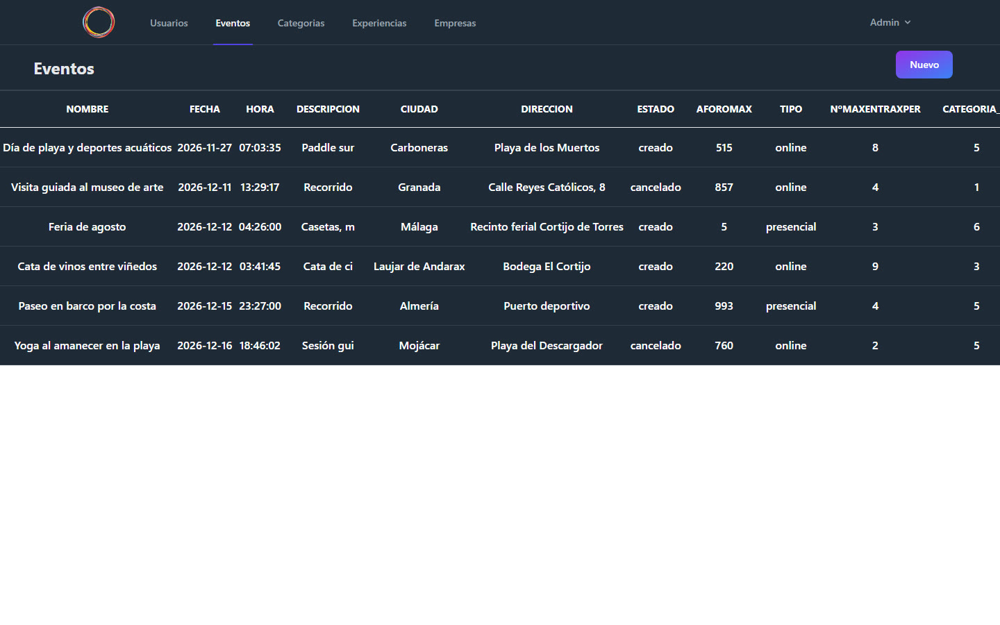

# Agenda de eventos

Aplicación web para una agencia: publica una agenda de eventos y las experiencias que ofrecen empresas de la zona, y gestiona las inscripciones. La hice en 2024 con Laravel.


| Ficha de un evento | Panel de administración |
|---|---|
|  |  |

## Qué hace

La web pública muestra la agenda, que se puede filtrar por categoría o por esta semana y este mes, la ficha de cada evento y las experiencias de las empresas.

Hay tres tipos de usuario. El administrador gestiona categorías, empresas, experiencias, usuarios y todos los eventos. El creador de eventos solo ve y edita los suyos, y las inscripciones que reciben. El asistente se registra y se apunta a los eventos eligiendo cuántas entradas quiere.

Al inscribirse se comprueba que no se haya apuntado ya, que no pida más entradas de las permitidas por persona, que quede aforo y que el evento siga abierto.

También tiene una API (`/api/v1/agencult/...`). Consultar eventos, categorías y experiencias es público. Crear o borrar eventos y ver los datos de los asistentes necesita token (Laravel Sanctum).

Tecnologías: Laravel, PHP, MySQL, Blade, Tailwind CSS, Laravel Breeze y Laravel Sanctum.

Tablas principales: `users` (con rol), `categorias`, `eventos`, `inscripciones`, `empresas` y `experiencias`.

## Cómo arrancarlo

```bash
composer install
npm install && npm run build
cp .env.example .env
php artisan key:generate
php artisan migrate
php artisan storage:link
php artisan serve
```
