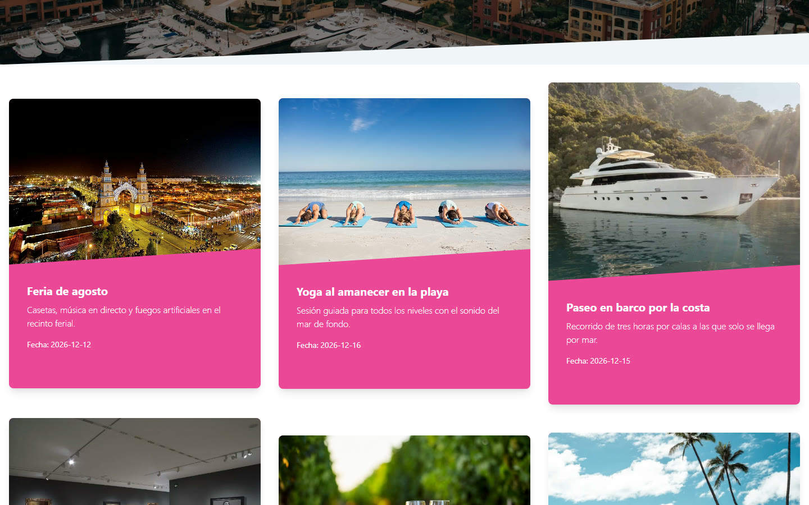

# Agenda · eventos y experiencias

Aplicación web para una agencia: publica una agenda de eventos y las experiencias que ofrecen empresas de la zona, y gestiona las inscripciones de los asistentes. La hice durante el ciclo de Desarrollo de Aplicaciones Web (DAW, 2024).



| Ficha de un evento | Panel de administración |
|---|---|
|  |  |

## Qué hace
**Web pública**
- Agenda de eventos con filtro por categoría y por «esta semana» o «este mes».
- Ficha de cada evento: fecha, hora, lugar, aforo e imagen.
- Experiencias de empresas y página «Explora» con información turística.

**Tres tipos de usuario**
- **Administrador:** gestiona categorías, empresas, experiencias, usuarios y todos los eventos.
- **Creador de eventos:** crea, edita y borra **sus** eventos, y ve las inscripciones que reciben.
- **Asistente:** se registra y se inscribe a los eventos eligiendo el número de entradas.

**Reglas de las inscripciones**
- Una inscripción por persona y evento.
- Nunca más entradas que el máximo por persona de ese evento.
- No se puede pasar del aforo del evento: se avisa de cuántas entradas quedan.
- Solo se admiten inscripciones en eventos abiertos.

**API REST** (`/api/v1/agencult/...`)
- **Pública:** consultar eventos, categorías y experiencias.
- **Con token (Laravel Sanctum):** crear y borrar eventos, y consultar asistentes y sus inscripciones.

## Tecnologías
Laravel · PHP · MySQL · Blade · Tailwind CSS · Laravel Breeze · Laravel Sanctum

## Base de datos
`users` (con rol) · `categorias` · `eventos` · `inscripciones` · `empresas` · `experiencias`
- Un evento pertenece a una categoría y a su creador.
- Una inscripción une a un asistente con un evento.
- Una experiencia pertenece a una empresa.

## Cómo arrancarlo
```bash
composer install
npm install && npm run build
cp .env.example .env
php artisan key:generate
php artisan migrate
php artisan storage:link
php artisan serve
```
